<p align="center">
  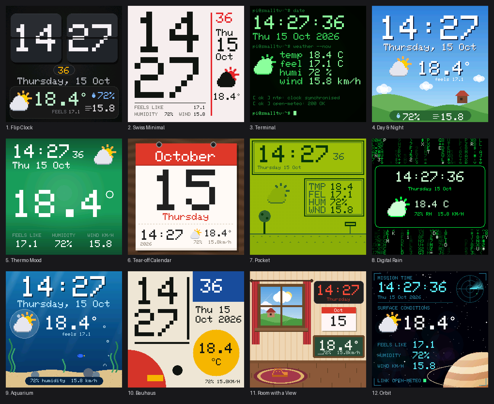
</p>

<h1 align="center">SmallTV Clock &amp; Weather Themes</h1>

<p align="center">
  Twelve clock faces for the <b>GeekMagic SmallTV</b> running <a href="https://github.com/giovi321/smalltv-mod">smalltv-mod</a>.<br/>
  <b>No home server needed:</b> the time comes from the TV itself, the weather from <a href="https://open-meteo.com">Open-Meteo</a> (free, no account, no API key).
</p>

---

## Contents

- [The themes](#the-themes)
- [Install a theme](#install-a-theme)
- [Set your location and units](#set-your-location-and-units)
- [What the weather data is](#what-the-weather-data-is)
- [Package sizes](#package-sizes)
- [Rebuilding and making your own](#rebuilding-and-making-your-own)
- [How they're built](#how-theyre-built)
- [Troubleshooting](#troubleshooting)
- [Credits](#credits)

Looking for a Home Assistant + Proxmox dashboard instead? See [smalltv-ha-dashboard](https://github.com/IdoKimhi/smalltv-ha-dashboard).

---

## The themes

Every preview below is rendered with [smalltv-studio](https://github.com/giovi321/smalltv-studio)'s device-exact renderer: six seconds of the theme's real animation, with the clock ticking.

<table>
<tr>
<td width="50%" valign="top">
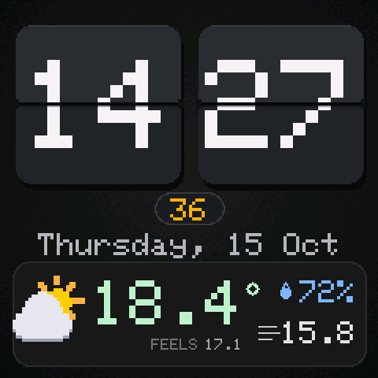

### 1. Flip Clock
[`flip/clock-flip.stheme`](flip/clock-flip.stheme)

Split-flap cards for hours and minutes, amber seconds in a pill, the full date, and a weather strip with an animated icon, temperature, "feels like", humidity and wind.
</td>
<td width="50%" valign="top">
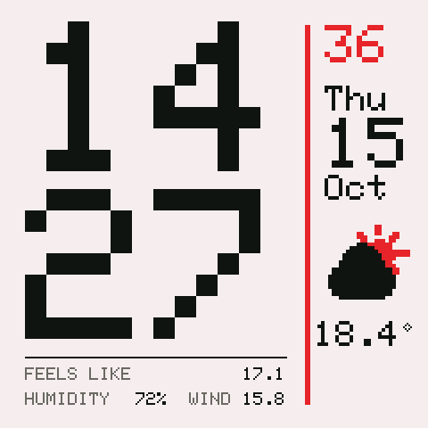

### 2. Swiss Minimal
[`swiss/clock-swiss.stheme`](swiss/clock-swiss.stheme)

International Typographic Style on off-white paper: giant stacked hours and minutes, a signal-red rule and seconds, and a quiet date and weather column. The weather icon becomes a flat ink-and-red silhouette. **Light theme.**
</td>
</tr>
<tr>
<td valign="top">
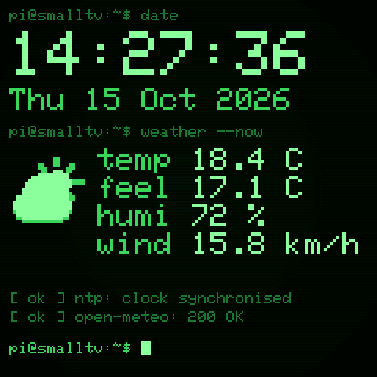

### 3. Terminal
[`terminal/clock-terminal.stheme`](terminal/clock-terminal.stheme)

A green-phosphor shell session: scanlines, a soft CRT glow, `$ date` and `$ weather --now` prompts printing key/value output, boot-style status lines, and a blinking cursor.
</td>
<td valign="top">
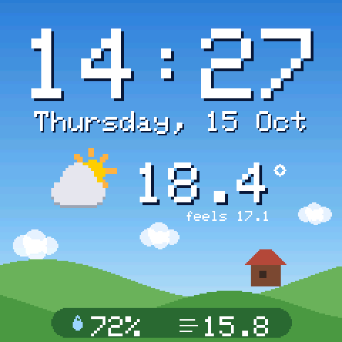

### 4. Day &amp; Night
[`sky/clock-sky.stheme`](sky/clock-sky.stheme)

A pixel landscape with rolling hills and a little house. It **switches between a bright day sky and a starry night** with a lit window, following sunrise and sunset at your location.

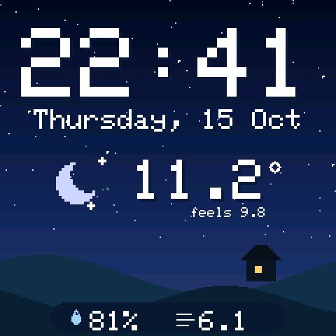
</td>
</tr>
<tr>
<td valign="top">
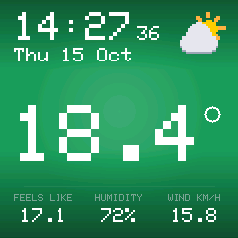

### 5. Thermo Mood
[`mood/clock-mood.stheme`](mood/clock-mood.stheme)

The **whole screen takes the color of the outdoor temperature**, from icy blue through teal, green and amber to crimson, behind one huge reading.

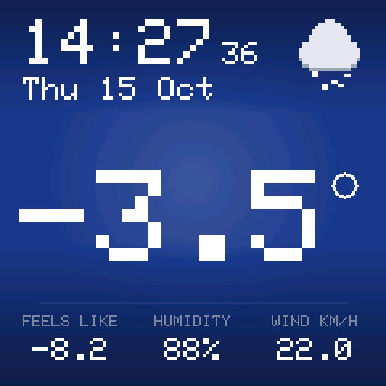 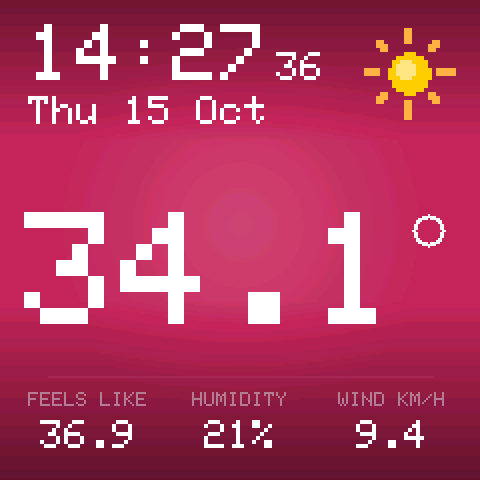
</td>
<td valign="top">
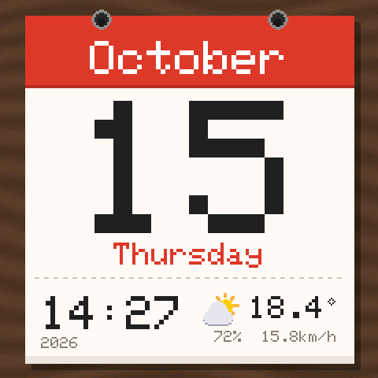

### 6. Tear-off Calendar
[`calendar/clock-calendar.stheme`](calendar/clock-calendar.stheme)

A tear-off calendar page on a wooden desk: red month header with binding rings, a giant day number, the weekday, and the time and weather along a perforated foot. **Light theme.**
</td>
</tr>
<tr>
<td valign="top">
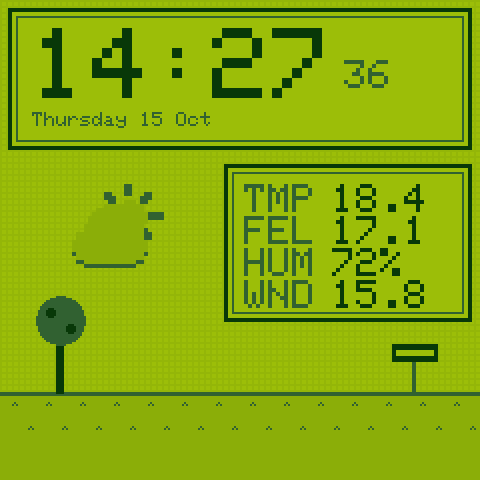

### 7. Pocket
[`pocket/clock-pocket.stheme`](pocket/clock-pocket.stheme)

A four-shade handheld-console screen with a faint LCD grid: dialog-box clock, an RPG-style stat window for the weather (TMP / FEL / HUM / WND), and a little character walking across the grass.
</td>
<td valign="top">
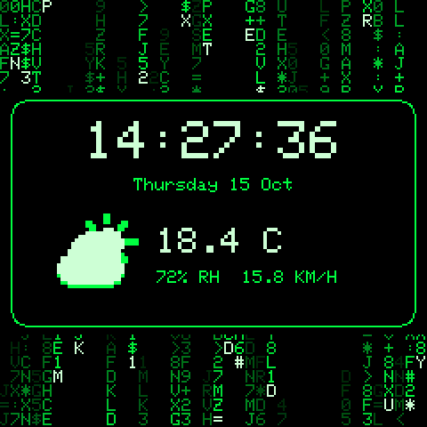

### 8. Digital Rain
[`matrix/clock-matrix.stheme`](matrix/clock-matrix.stheme)

Columns of falling green glyphs (a seamless 16-frame loop) above and below a black console with the time, seconds, date and weather.
</td>
</tr>
<tr>
<td valign="top">
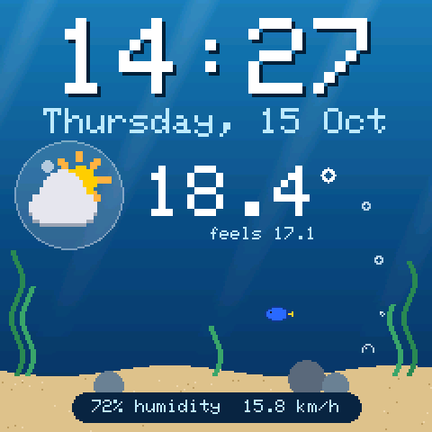

### 9. Aquarium
[`aquarium/clock-aquarium.stheme`](aquarium/clock-aquarium.stheme)

Light rays, seaweed and sand. A clownfish and a blue tang swim past while bubbles rise, and the weather icon floats inside a bubble.
</td>
<td valign="top">
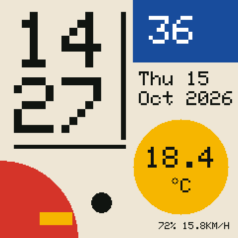

### 10. Bauhaus
[`bauhaus/clock-bauhaus.stheme`](bauhaus/clock-bauhaus.stheme)

Flat primary shapes in a poster composition. Instead of an icon, **the big circle changes color with the weather**: yellow sun, grey cloud and fog, blue rain, white snow, violet storm. **Light theme.**

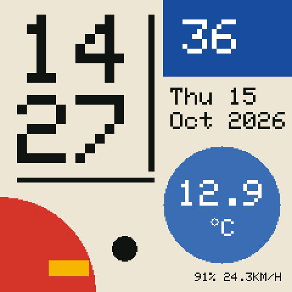
</td>
</tr>
<tr>
<td valign="top">
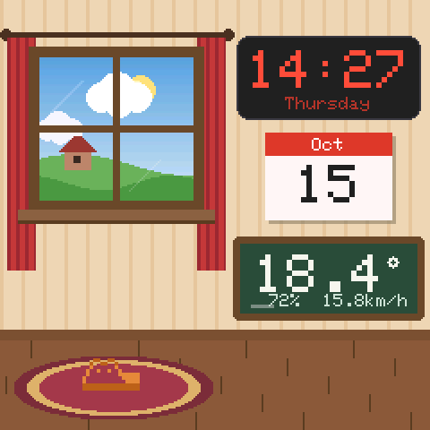

### 11. Room with a View
[`window/clock-window.stheme`](window/clock-window.stheme)

A cozy pixel room. **The window shows the real weather outside**: sun and gliding birds, drifting clouds, rain, snow, a lightning storm, or a starry night with a lit house. Around it are an LED clock, a wall calendar and a chalkboard thermometer, with a ginger cat asleep on the rug.

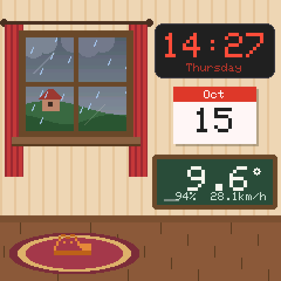 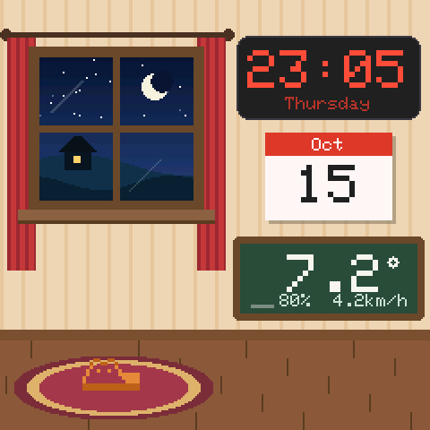
</td>
<td valign="top">
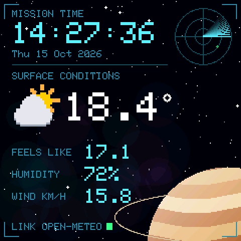

### 12. Orbit
[`orbit/clock-orbit.stheme`](orbit/clock-orbit.stheme)

Mission control over deep space: a nebula, a ringed gas giant, a rotating radar sweep with fading blips, and a cyan HUD with mission time and surface conditions.
</td>
</tr>
</table>

All the weather icons (sun, moon, partly cloudy, cloud, rain, snow, storm) are small looping animations, kept slow so they don't pull your eye all day.

---

## Install a theme

1. Download the `.stheme` file of the theme you want (open it above, then **Download raw file**).
2. **[Set your location](#set-your-location-and-units).** Every theme ships with London's coordinates.
3. Install it, either:
   - **On the TV:** open the TV's web UI, go to the **Display** tab, upload the `.stheme` under the theme section, and select it.
   - **With [smalltv-studio](https://github.com/giovi321/smalltv-studio):** open the `.stheme`, click **Send to TV**, enter the TV's IP address, and activate it.

The clock works as soon as the TV has synced its time. The weather fills in after the first fetch, a few seconds after the theme starts, and then refreshes every 10 minutes.

---

## Set your location and units

Every theme fetches this URL:

```
http://api.open-meteo.com/v1/forecast?latitude=51.51&longitude=-0.13&current=temperature_2m,apparent_temperature,relative_humidity_2m,weather_code,wind_speed_10m,is_day&timezone=auto
```

To use your own location:

1. Find your coordinates. Right-click a spot in Google Maps and the first line is `latitude, longitude`.
2. Open the `.stheme` in [smalltv-studio](https://github.com/giovi321/smalltv-studio) (drop it on the page).
3. In the **Data** tab, replace `latitude=51.51&longitude=-0.13` in the URL with yours.
4. Export (**Ctrl/Cmd S**) or use **Send to TV**.

Units are options on the same URL. Add them at the end:

| Want | Add |
| --- | --- |
| Fahrenheit | `&temperature_unit=fahrenheit` |
| Wind in mph | `&wind_speed_unit=mph` |
| Wind in m/s or knots | `&wind_speed_unit=ms` / `&wind_speed_unit=kn` |

The labels baked into a few themes say "km/h" or "C". If you switch units, those labels don't change, but the numbers do.

> The TV only reads responses up to 2 KiB. This URL returns about 600 bytes, so there is room for extra `current=` fields if you want to build on it.

---

## What the weather data is

Each theme declares one data source with six fields, read from Open-Meteo's `current` block:

| Field | Open-Meteo value | Example | Used for |
| --- | --- | --- | --- |
| `w.t` | `current.temperature_2m` | `18.4` | Temperature (and its color in several themes) |
| `w.f` | `current.apparent_temperature` | `17.1` | "Feels like" |
| `w.h` | `current.relative_humidity_2m` | `72` | Humidity % |
| `w.c` | `current.weather_code` | `2` | Which icon or scene is shown ([WMO code](https://open-meteo.com/en/docs#weather_variable_documentation)) |
| `w.w` | `current.wind_speed_10m` | `15.8` | Wind speed |
| `w.d` | `current.is_day` | `1` / `0` | Day or night icon / scene |

Values are printed exactly as Open-Meteo sends them, which is why temperatures show one decimal (`18.4`). The TV can't round numbers. Temperatures are right-aligned so the `°` always lands right after them.

Weather codes are grouped like this:

| Codes | Shown as |
| --- | --- |
| 0–1 | Sun (day) or moon (night) |
| 2 | Partly cloudy |
| 3–48 | Cloudy, fog |
| 49–67 | Drizzle, rain |
| 68–79 | Snow |
| 80–84 | Rain showers |
| 85–94 | Snow showers |
| 95–99 | Thunderstorm |

---

## Package sizes

The TV stores themes in its own flash. Check the free space in its web UI, and remove themes you don't use if a large one doesn't fit.

| Theme | Size | | Theme | Size |
| --- | --- | --- | --- | --- |
| Bauhaus | 115 KiB | | Day & Night | 691 KiB |
| Tear-off Calendar | 234 KiB | | Orbit | 748 KiB |
| Swiss Minimal | 578 KiB | | Pocket | 849 KiB |
| Terminal | 578 KiB | | Room with a View | 870 KiB |
| Flip Clock | 584 KiB | | Digital Rain | 1247 KiB |
| Thermo Mood | 635 KiB | | Aquarium | 1356 KiB |

Most of the size is animation frames; the animated weather icons alone are about 450 KiB.

---

## Rebuilding and making your own

Every theme is generated by code. `lib.mjs` holds the shared toolkit, each folder's `theme.mjs` holds one design, and `build-all.mjs` validates, packs and renders previews with smalltv-studio's own core. That's the same code that is checked byte-for-byte against the firmware's packer.

1. Clone smalltv-studio and install its dependencies:

   ```bash
   git clone https://github.com/giovi321/smalltv-studio.git
   cd smalltv-studio
   npm install
   ```

2. Clone this repo into a `clock-themes` folder inside it:

   ```bash
   git clone https://github.com/IdoKimhi/smalltv-clock-themes.git clock-themes
   ```

3. Build every theme from the smalltv-studio root:

   ```bash
   node clock-themes/build-all.mjs
   ```

   Or build only some:

   ```bash
   node clock-themes/build-all.mjs flip window
   ```

   Then regenerate the GIFs, `gallery.png` and a local `gallery.html` (needs `pip install pillow`):

   ```bash
   python clock-themes/gallery.py
   ```

To bake in your own location, change `WEATHER_URL` at the top of `lib.mjs` before building.

To make a new theme, copy a folder, edit its `theme.mjs`, and add its name to `ALL` in `build-all.mjs` and `ORDER` in `gallery.py`. The toolkit gives you:

| Helper | What it does |
| --- | --- |
| `canvas(w, h, palette)` | A pixel canvas: rectangles, discs, rings, lines, rounded rectangles, gradients, alpha blending |
| `g.text(...)` | Draws text in the device's own 5×7 font, pixel for pixel, to bake labels into backgrounds |
| `weatherIcons(assets, { x, y, k, palette })` | Adds the nine animated weather layers with their show/hide bindings; `palette` recolors them (see Terminal, Pocket, Swiss) |
| `bandBind(lo, hi, day, x, y)` | The bindings that show any layer only for a range of weather codes (Room with a View uses it for its window scenes) |
| `weatherSource(fields)` | The Open-Meteo data source |
| `addImage`, `addAnimation` | Turn canvases into package images and animation frames |
| `text`, `image`, `anim`, `rect`, `circle`, `degree`, `stops` | Manifest layer shortcuts |

---

## How they're built

The theme format is deliberately small: text, images, animations and three shapes, 32 layers at most, and *bindings* that map a fetched number onto a position, size or color. These themes rely on a few tricks:

- **Switching icons and scenes:** images can't be swapped by data, so every icon is in the theme at once. Each one has two step-shaped bindings on the weather code: `x` moves it off-screen when the code is above its range, and `y` when the code is below. For clear skies, `y` follows `is_day` instead, which picks the sun or the moon. The same trick swaps the whole landscape in Day & Night.
- **A degree sign the font doesn't have:** the device font is printable ASCII only, so `°` is a small circle shape placed after right-aligned text.
- **Color from data:** Thermo Mood's background is a full-screen rectangle whose fill color is bound to the temperature, with a translucent shading image on top. Bauhaus binds its circle's color, and the text inside it, to the weather code.
- **Baked backgrounds:** everything static (gradients, scenes, labels in the device font) is drawn once into a background image, which leaves the 32 layers for the parts that change.
- **Small animation areas:** Digital Rain only animates the bands above and below its console, which keeps the package at about half the size of full-screen rain.

---

## Troubleshooting

| Symptom | Cause / fix |
| --- | --- |
| Clock shows `--:--` | The TV hasn't synced its time yet. It fills in on its own. |
| Weather shows `--` | The TV hasn't fetched the data yet, or can't reach `api.open-meteo.com` (check its internet connection). Values appear within seconds of a successful fetch. |
| The weather is for London | Set your coordinates (see [above](#set-your-location-and-units)). |
| "Not enough space" when installing | Remove unused themes on the TV, or pick a smaller theme (see [Package sizes](#package-sizes)). |
| Wrong icon at night | Open-Meteo decides day or night from your coordinates and `timezone=auto`. Check that the coordinates are yours. |

---

## Credits

- **[smalltv-mod](https://github.com/giovi321/smalltv-mod)**: the custom firmware and the `.stheme` format.
- **[smalltv-studio](https://github.com/giovi321/smalltv-studio)**: the theme editor whose core packs, validates and renders these themes.
- **[Open-Meteo](https://open-meteo.com)**: free weather API (free for non-commercial use, CC BY 4.0 data).
- Text is drawn with the classic **Adafruit GFX** 5×7 bitmap font used by the firmware (BSD license, see smalltv-studio's `src/core/FONT-LICENSE.txt`).
- Not affiliated with GeekMagic.
